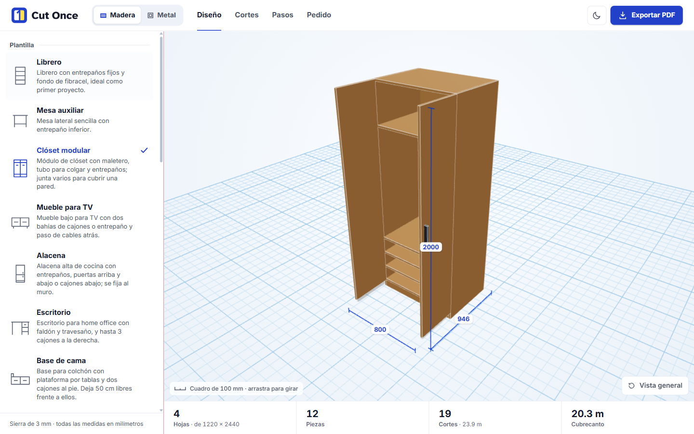
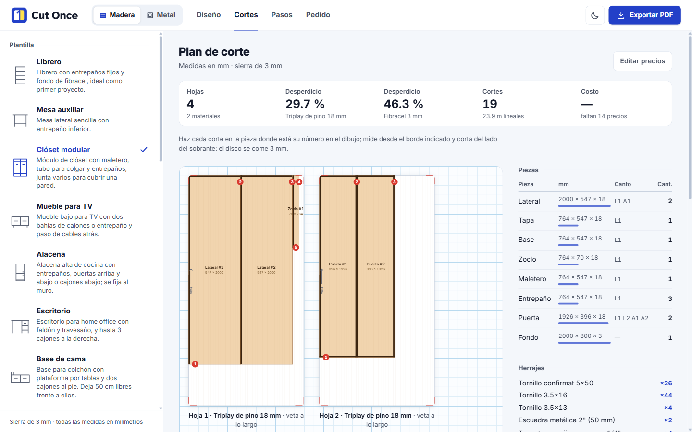
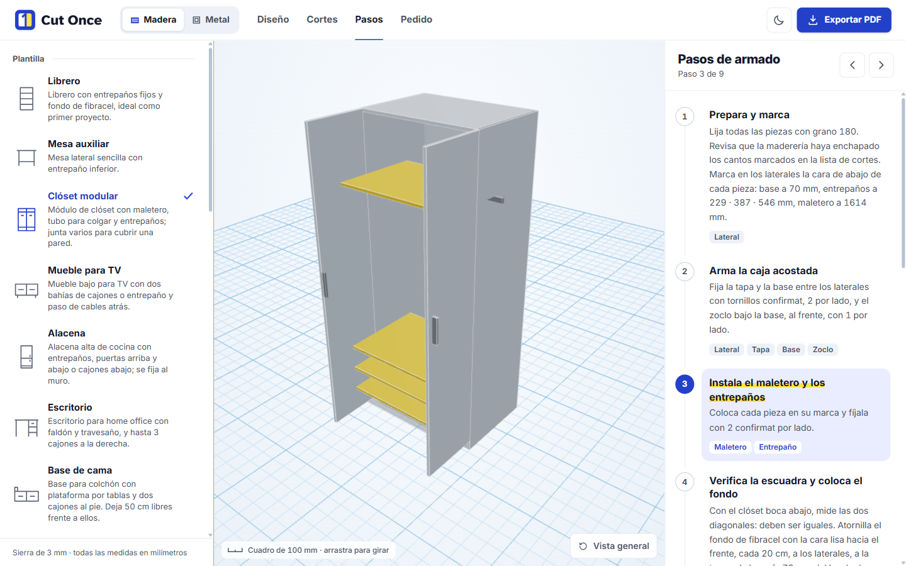
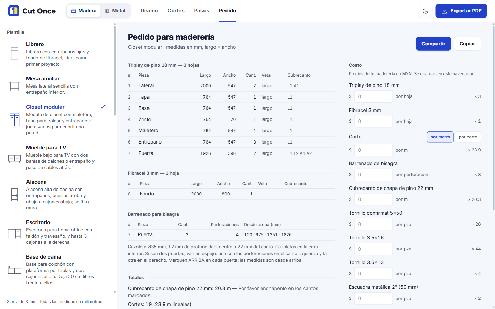
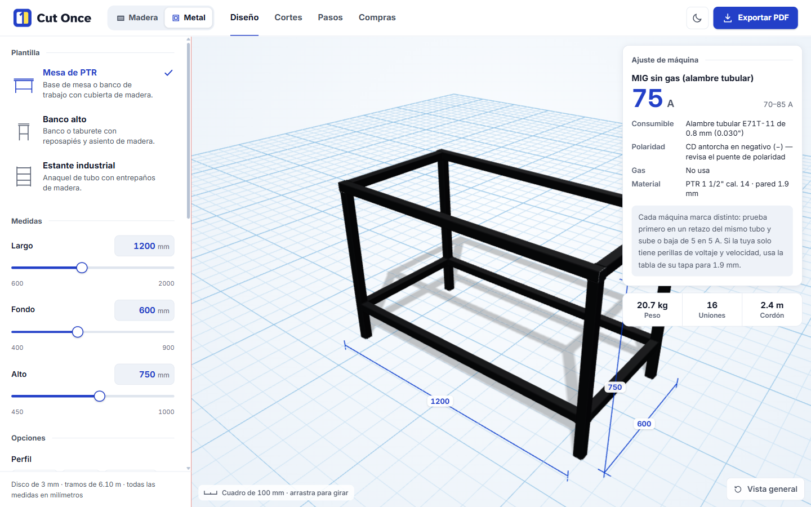
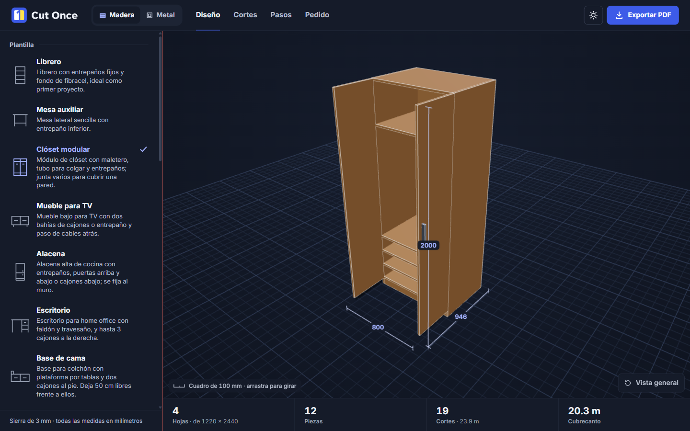
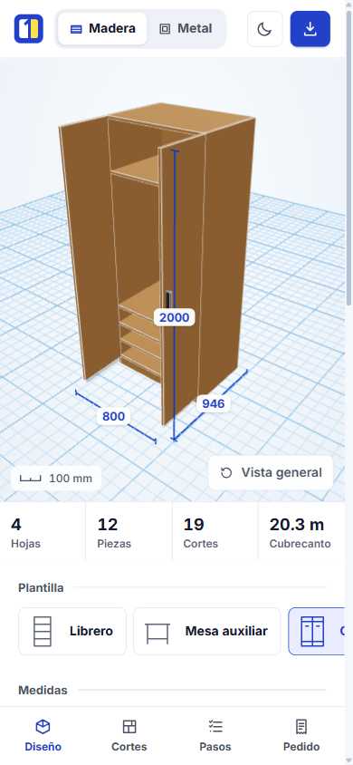

<div align="center">

<picture>
  <source media="(prefers-color-scheme: dark)" srcset="brand/cut-once/logo/horizontal/cut-once-horizontal-on-dark.svg">
  
</picture>

**Design furniture. Get the cuts, the lumber-yard order and the build steps.**

A beginner-friendly planner for plywood furniture and welded tube projects, built for first-time makers in Mexico.

[**Open the app →**](https://plywood-planner-zeta.vercel.app)


</div>

<p align="center">
  
</p>

## Why

Cut optimizers stop at a list of pieces. Pro suites assume you are a carpenter. Cut Once goes the whole way for a beginner: **furniture → pieces → an order the lumber yard can cut and band as written → numbered build steps**, in Mexican materials, sheet sizes and trade vocabulary.

Pick a template, drag the sliders, and the app refuses to let you design something that will sag, won't fit a sheet, or can't be cut.

> The UI is in Spanish (es-MX). All measurements are millimetres.

## Features

| | |
|---|---|
| **3D preview** | Every panel, door, drawer and handle, drawn from the same data as the cut plan. Doors swing open and drawers pull out so you can see inside. |
| **Optimized cut plan** | Sheets nested with guillotine-cuttable shelf packing, kerf counted as waste, grain respected, and every saw cut numbered in order. |
| **Lumber-yard order** | A parts list in the format a Mexican *maderería* expects (L × A × qty, grain, banded edges L1/L2/A1/A2, hinge boring), shared as plain text. |
| **Cost** | Enter your yard's prices once: sheets, cutting per metre or per cut, banding, boring and hardware. Saved in your browser only. |
| **Build steps** | Numbered assembly steps that highlight the parts involved in 3D, plus anti-tip wall fixing for tall pieces. |
| **Metal mode** | Welded PTR tube projects with a 6.10 m bar cut plan, welder amps and polarity per process, and a shopping list. |
| **PDF export** | One click prints the whole project: model, cut diagrams, order and steps. |
| **Day and night** | A grid-notebook look in light and dark, with a print palette that comes for free. |

## Screenshots

<table>
  <tr>
    <td width="50%"><br><sub><b>Cortes</b>: sheets, waste per material, numbered saw sequence.</sub></td>
    <td width="50%"><br><sub><b>Pasos</b>: the active step's parts light up in 3D.</sub></td>
  </tr>
  <tr>
    <td width="50%"><br><sub><b>Pedido</b>: the order for the counter, plus your own prices.</sub></td>
    <td width="50%"><br><sub><b>Metal</b>: tube frames with machine settings.</sub></td>
  </tr>
  <tr>
    <td width="50%"><br><sub>Night theme.</sub></td>
    <td width="50%" align="center"><br><sub>Phone layout, for the shop floor.</sub></td>
  </tr>
</table>

## Templates

**Madera (wood):** Librero · Mesa auxiliar · Clóset modular · Mueble para TV · Alacena · Escritorio · Base de cama · Zapatera · Repisas flotantes

**Metal (welded tube):** Mesa de PTR · Banco alto · Estante industrial

Materials: pine plywood 12 / 15 / 18 mm, white melamine 16 mm and Fibracel 3 mm, all in 1220 × 2440 sheets.

## How it works

A template is **not** a 3D model. It is a pure function:

```ts
(params: TemplateParams) => Design
```

`Design` holds the full panel list (size, grain, quantity, stock, banded edges), hardware, 3D placements and assembly steps. The 3D scene, the cut diagram, the order, the cost and the instructions are all renderings of that one value. Change a slider and everything updates, because there is nothing else to update.

The engine encodes the constraints that bite when you cut a real sheet:

- **Grain matters.** A panel marked `'length'` runs along the sheet's grain; the nester won't rotate it to save space.
- **Kerf is waste.** The 3 mm blade is counted between pieces, not at sheet edges.
- **Shelves sag.** Each material has a maximum unsupported span (500 mm for 12 mm plywood up to 800 mm for 18 mm). Go past it and you get a plain-Spanish message under the field.
- **Materials never share a sheet.** Each stock is nested and reported on its own.
- **Every cut is makeable.** FFDH shelf packing is guillotine-cuttable by construction, and the saw sequence is numbered so the order, the cost and the steps always agree.

`src/engine/` is pure TypeScript with no React, DOM or three.js imports, so the Expo iOS app in `mobile/` runs the very same engine without a copy.

## Getting started

Requires Node 22.18+ (the demo script runs TypeScript natively) and [pnpm](https://pnpm.io).

```bash
pnpm install
pnpm dev
```

| Command | What it does |
|---|---|
| `pnpm dev` | Vite dev server at http://localhost:5173 |
| `pnpm test` | Full Vitest suite |
| `pnpm typecheck` | Strict `tsc`, no emit |
| `pnpm build` | Typecheck and production build |
| `pnpm demo` | Nest a bookshelf and print the sheet layout as ASCII, no browser needed |

### iOS app

The native client lives in `mobile/` and uses npm, not pnpm:

```bash
cd mobile
npm install
npm run web   # preview at phone size without a Mac
```

## Project layout

```
src/engine/       pure TypeScript: templates, nesting, cut sequence, order, cost, welding
src/components/   3D viewer, param form, cut diagram, steps, order, print report
src/index.css     Tailwind v4 @theme tokens: the whole design system, both themes and print
mobile/           Expo iOS client, importing the same src/engine/
brand/cut-once/   logo kit and usage guide
docs/             design specs per phase, and README screenshots
scripts/          Node-only entry points (the ASCII demo)
```

## Stack

Vite · React 18 · TypeScript · Tailwind CSS v4 · react-three-fiber + drei · Zustand · Vitest · pnpm · Expo (iOS)

## Roadmap

- [x] Engine, 3D viewer, cut diagrams, build steps, PDF export
- [x] Materials, edge banding, lumber-yard order and cost, numbered saw sequence
- [x] Doors, drawers and templates for small homes
- [x] Metal mode for welded tube projects
- [ ] Fit a measured space, tool-aware steps, offcut suggestions
- [ ] Save, share and remix designs
- [ ] Carpenter mode and lumber-yard partners

## License

MIT. See [LICENSE](LICENSE).
